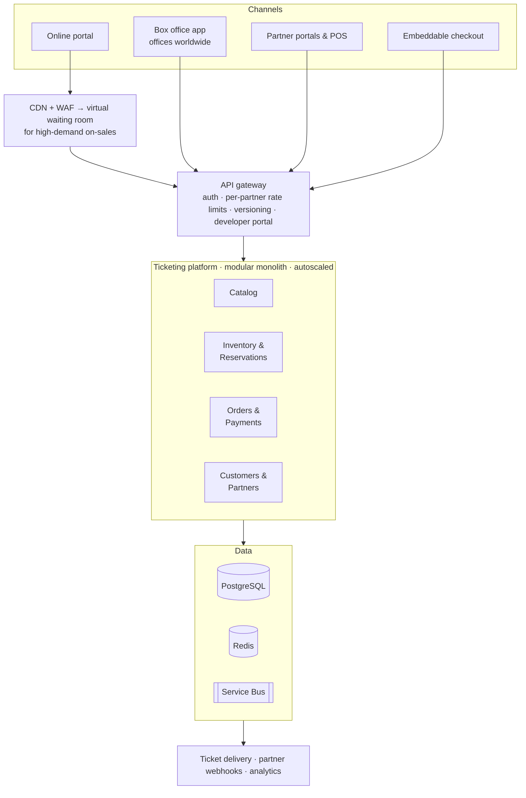
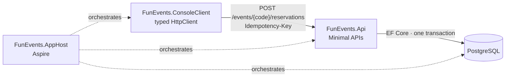

# FunEvents Ticketing


Technical assessment for a multi-channel ticketing platform:

1. **Part 1, architecture:** how FunEvents sells tickets through its online portal, its customer service offices around the world and partner portals that integrate with it. → [`docs/architecture.md`](docs/architecture.md)
2. **Part 2, prototype:** a web API that reserves tickets for a known event and user, and a console client to test it, with .NET 10, ASP.NET Core Minimal APIs, PostgreSQL and Aspire. → [`docs/implementation-plan.md`](docs/implementation-plan.md)

The property everything is built around: **tickets are never oversold**, not even when many buyers press "buy" at the same time.

---

## Part 1: architecture in one page



- **One API for every channel**, behind a gateway that authenticates, rate-limits per partner and publishes a developer portal. Partners choose between the REST API with webhooks (full control of their UX), an embeddable white-label checkout, or deep links.
- **Modular monolith first.** It scales horizontally like any service. The real scaling problems of ticketing, the on-sale surge and the contention on one event's inventory, are solved at the edge and in the data model, not by splitting the code. *Inventory & Reservations* is the first module to extract if it ever needs to scale alone.
- **Never oversell:** an atomic conditional update on the inventory, a database check constraint as a safety net, and 10-minute holds that expire if not paid.
- **Safe retries:** every write accepts an `Idempotency-Key`.
- **On-sale spikes:** a SaaS virtual waiting room admits buyers at the rate checkout can process; the platform is scaled out ahead of announced on-sales.
- **Reliable events:** outbox pattern where consistency matters (inventory, payments), feeding ticket delivery, partner webhooks and analytics.

Full document with system context, containers, reserve-and-pay sequence, on-sale flow, inventory model, scalability, security and evolution path: [`docs/architecture.md`](docs/architecture.md).

## Part 2: the prototype



| Method | Route | Purpose |
|---|---|---|
| `GET` | `/events/{eventCode}` | Event and current availability |
| `POST` | `/events/{eventCode}/reservations` | Reserve tickets for a user (optional `Idempotency-Key`) |
| `GET` | `/reservations/{reservationId}` | A reservation |

The plan covers the API contract and error codes, the data model, the reservation algorithm, the console client, an 18-case test plan (including 50 concurrent buyers for 10 tickets) and the build order: [`docs/implementation-plan.md`](docs/implementation-plan.md).

> **Status:** design complete, implementation in progress. Run instructions will be added here with the code.

## Decisions

| ADR | Decision |
|---|---|
| [0001](docs/adr/0001-modular-monolith.md) | Start as a modular monolith |
| [0002](docs/adr/0002-atomic-conditional-update-for-inventory.md) | Prevent overselling with an atomic conditional update |
| [0003](docs/adr/0003-idempotency-keys.md) | Idempotency keys on reservation requests |
| [0004](docs/adr/0004-buy-the-virtual-waiting-room.md) | Buy the virtual waiting room instead of building it |
| [0005](docs/adr/0005-core-driven-structure.md) | Core-Driven structure for the prototype |
| [0006](docs/adr/0006-dotnet-10-minimal-apis-aspire.md) | .NET 10, Minimal APIs and Aspire |

## Repository layout

```text
docs/
├── architecture.md          Part 1: the architecture proposal
├── implementation-plan.md   Part 2: analysis and plan for the prototype
└── adr/                     Architecture decision records
src/                         (coming) AppHost, ServiceDefaults, Contracts, Api, ConsoleClient
tests/                       (coming) Integration tests with Testcontainers
```

## References

- Ticketmaster, *Guide to Smart Queue*: waiting room, queue and the 10-minute hold
- SeatGeek at QCon, *How SeatGeek Successfully Handles High Demand Ticket On-Sales*
- Shopify Engineering, modular monolith under flash-sale load
- ByteByteGo, *System Design Interview*, hotel reservation chapter
- NetMentor (Iván Abad): *Construyendo sistemas distribuidos*; articles on Core-Driven architecture, idempotency and event consistency

## License

[MIT](LICENSE)
