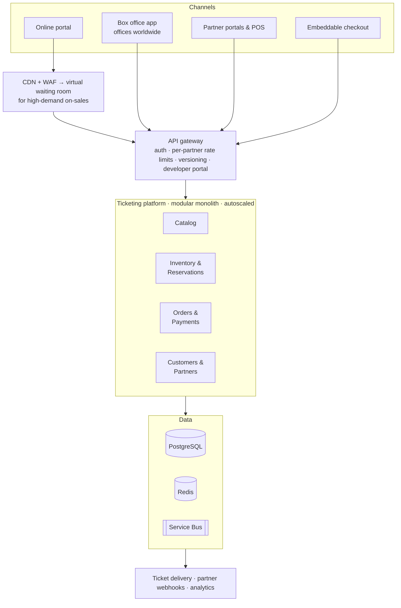
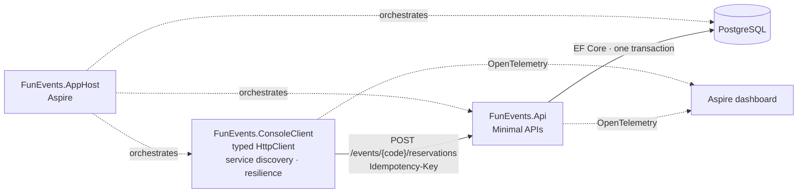
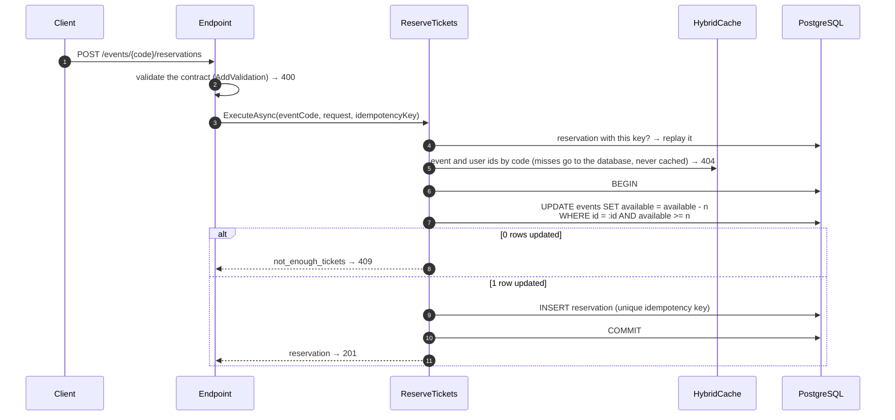

# FunEvents Ticketing

[](https://github.com/juanfernandez03/funevents-ticketing/actions/workflows/ci.yml)


Technical assessment for a multi-channel ticketing platform:

1. **Part 1, architecture:** how FunEvents sells tickets through its online portal, its customer service offices around the world and partner portals that integrate with it. → [`docs/architecture.md`](docs/architecture.md)
2. **Part 2, prototype:** a web API that reserves tickets for a known event and user, and a console client to test it, with .NET 10, ASP.NET Core Minimal APIs, PostgreSQL and Aspire. Built test first. → [`docs/implementation-plan.md`](docs/implementation-plan.md)

The property everything is built around: **tickets are never oversold**, not even when many buyers press "buy" at the same time.

---

## Contents

- [Quick start](#quick-start)
- [Part 1: architecture in one page](#part-1-architecture-in-one-page)
- [Part 2: the prototype](#part-2-the-prototype)
  - [API](#api)
  - [Console client](#console-client)
  - [How a reservation works](#how-a-reservation-works)
  - [Project structure](#project-structure)
  - [Tests](#tests)
- [Decisions](#decisions)
- [What is deliberately left out](#what-is-deliberately-left-out)
- [How this repository was built](#how-this-repository-was-built)

---

## Quick start

**Prerequisites:** [.NET 10 SDK](https://dotnet.microsoft.com/download/dotnet/10.0) and a running Docker engine (Docker Desktop, Podman or similar).

```bash
git clone https://github.com/juanfernandez03/funevents-ticketing.git
cd funevents-ticketing
dotnet run --project src/FunEvents.AppHost
```

The console prints the Aspire dashboard URL with its login token. In the dashboard:

| Resource | What it is |
|---|---|
| `postgres` / `funevents` | PostgreSQL container and database, recreated and seeded on every run |
| `api` | The reservations API. `/scalar` on its URL opens the interactive API reference |
| `client-reserve` | Console client: reserves 2 tickets of `ROCK-BCN-2027` for `USR-001`. Press **Start** |
| `client-rush` | Console client: 50 buyers race for the 10 tickets of `JAZZ-VLC-2027`. Press **Start** |

Each client's output is in its console logs, and the **Traces** tab follows every request from the client through the API down to the SQL statements. Both scenarios can be started again; `client-rush` then gets 50 × `409`, because the tickets are gone.

### Without Aspire

```bash
# 1. PostgreSQL
docker run -d --name funevents-db -e POSTGRES_PASSWORD=postgres -p 5432:5432 postgres:18.3

# 2. API on http://localhost:5080 (applies migrations and seed data in Development)
ConnectionStrings__funevents="Host=localhost;Database=funevents;Username=postgres;Password=postgres" \
  dotnet run --project src/FunEvents.Api --launch-profile http

# 3. Client, in another terminal
dotnet run --project src/FunEvents.ConsoleClient -- --event ROCK-BCN-2027 --user USR-001 --quantity 2
```

### Seed data

| Event code | Name | Tickets |
|---|---|---|
| `ROCK-BCN-2027` | Rock Night Barcelona | 500 |
| `HAMLET-MAD-2027` | Hamlet | 120 |
| `JAZZ-VLC-2027` | Jazz under the Stars | 10, small on purpose for the concurrency demo |

Users: `USR-001`, `USR-002`, `USR-003`.

---

## Part 1: architecture in one page



- **One API for every channel**, behind a gateway that authenticates, rate-limits per partner and publishes a developer portal. Partners choose between the REST API with webhooks (full control of their UX), an embeddable white-label checkout, or deep links.
- **Modular monolith first.** It scales horizontally like any service. The real scaling problems of ticketing, the on-sale surge and the contention on one event's inventory, are solved at the edge and in the data model, not by splitting the code. *Inventory & Reservations* is the first module to extract if it ever needs to scale alone.
- **Never oversell:** an atomic conditional update on the inventory, a database check constraint as a safety net, and 10-minute holds that expire if not paid.
- **Safe retries:** every write accepts an `Idempotency-Key`.
- **On-sale spikes:** a SaaS virtual waiting room admits buyers at the rate checkout can process; the platform is scaled out ahead of announced on-sales.
- **Reliable events:** outbox pattern where consistency matters (inventory, payments), feeding ticket delivery, partner webhooks and analytics.

Full document with system context, containers, reserve-and-pay sequence, on-sale flow, inventory model, scalability, security and evolution path: [`docs/architecture.md`](docs/architecture.md).

---

## Part 2: the prototype



### API

| Method | Route | Description |
|---|---|---|
| `GET` | `/events/{eventCode}` | Event details and current availability |
| `POST` | `/events/{eventCode}/reservations` | Reserve tickets for a user. Optional `Idempotency-Key` header |
| `GET` | `/reservations/{reservationId}` | A reservation |
| `GET` | `/openapi/v1.json`, `/scalar` | OpenAPI 3.1 document and interactive reference (Development) |
| `GET` | `/health`, `/alive` | Health checks (Development) |

**Reserve tickets**

```http
POST /events/ROCK-BCN-2027/reservations
Content-Type: application/json
Idempotency-Key: 3f6c1c1e-8d0b-4a57-9a51-2f1f3c8f6a10

{ "userCode": "USR-001", "quantity": 2 }
```

```http
HTTP/1.1 201 Created
Location: /reservations/01a1a635-1164-7ac6-8c63-d30383ef1ca7

{
  "id": "01a1a635-1164-7ac6-8c63-d30383ef1ca7",
  "eventCode": "ROCK-BCN-2027",
  "userCode": "USR-001",
  "quantity": 2,
  "createdAtUtc": "2026-11-04T10:57:38.123456+00:00"
}
```

The same request with the same key returns the same reservation with `Idempotent-Replayed: true` and takes no extra tickets.

**Errors** are [RFC 9457](https://www.rfc-editor.org/rfc/rfc9457) ProblemDetails with a machine-readable `code`:

| Status | `code` | When |
|---|---|---|
| `400` | none, field errors in `errors` | Missing user code, quantity outside 1–10, idempotency key over 64 characters, malformed JSON |
| `404` | `event_not_found`, `user_not_found`, `reservation_not_found` | Unknown code or id |
| `409` | `not_enough_tickets` | Fewer tickets left than requested |
| `422` | `idempotency_key_reused` | The key was already used for a different request |

```json
{
  "type": "https://tools.ietf.org/html/rfc9110#section-15.5.10",
  "title": "Conflict with the current state",
  "status": 409,
  "detail": "Event 'JAZZ-VLC-2027' does not have 8 ticket(s) available.",
  "code": "not_enough_tickets",
  "traceId": "00-c44f3387e993c59fe467f9e29104ebb4-96790947de325983-01"
}
```

### Console client

```text
FunEvents.ConsoleClient --event <code> --user <code> [options]

  --quantity <n>           Tickets per reservation (default: 1)
  --parallel <n>           Send n reservations at the same time (default: 1)
  --idempotency-key <key>  Reuse this key instead of a new one per request
  --api-url <url>          API base address (default: service discovery, http://localhost:5080)
```

It shows the event, reserves, and shows what is left. Every request carries an idempotency key, which is what makes the built-in HTTP retries safe for a `POST`. Exit codes: `0` done, `1` rejected or API unreachable, `2` invalid arguments.

One reservation:

```text
Rock Night Barcelona (ROCK-BCN-2027)
FunEvents Arena, Barcelona, 2027-03-20 20:00 UTC
Available: 500/500

Reserving 2 ticket(s) for USR-001 (Idempotency-Key: 1b408d21-f5ed-4a6f-8c53-1bcf2b33f792)...
[OK] Reservation 01a1a8ba-1a4e-78bb-b9dc-c263aa5a4638 created
     2 ticket(s) for ROCK-BCN-2027, user USR-001, at 2026-11-04 22:42:11Z

Available now: 498/500
```

`client-rush`, 50 buyers at the same time for 10 tickets:

```text
Jazz under the Stars (JAZZ-VLC-2027)
Open Air Stage, Valencia, 2027-06-05 21:00 UTC
Available: 10/10

Sending 50 reservations of 1 ticket(s) at the same time, a new key each...
Done in 445 ms

  201 Created      x10   created
  409 Conflict     x40   not_enough_tickets

Distinct reservations: 10, tickets reserved: 10

Available now: 0/10
```

Rejections show the API's reason:

```text
[FAILED] Reservation rejected: 404 Resource not found
         User 'NOPE' does not exist.
```

### How a reservation works



The heart of it, in [`ReserveTickets.cs`](src/FunEvents.Api/UseCases/Reservations/ReserveTickets.cs):

```csharp
await using var transaction = await db.Database.BeginTransactionAsync(cancellationToken);

// Check-and-decrement in a single statement. PostgreSQL locks the row and re-evaluates the
// WHERE clause after the lock, so concurrent buyers can never push the counter below zero.
var updatedRows = await db.Events
    .Where(e => e.Id == targetEvent.Id && e.AvailableTickets >= quantity)
    .ExecuteUpdateAsync(
        setters => setters.SetProperty(e => e.AvailableTickets, e => e.AvailableTickets - quantity),
        cancellationToken);

if (updatedRows == 0)
{
    LogNotEnoughTickets(targetEvent.Code, quantity);
    return ReservationErrors.NotEnoughTickets(targetEvent.Code, quantity);
}
```

- **Why not read, check and write?** Two requests both read "1 left" and both sell it. The history has the test that proves it: with the naive version, 50 buyers for 10 tickets all got a `201`.
- **Why not optimistic concurrency?** It is correct, but under contention most requests fail and retry. The conditional update needs no retry loop.
- **Safety net:** `CHECK (available_tickets >= 0 AND available_tickets <= total_tickets)` in the schema.
- **Idempotency races:** when two requests with the same key arrive together, the unique index lets one commit; the other's transaction rolls back, decrement included, and it replays the winner's reservation.
- **Retries:** the Aspire EF Core integration enables connection retries, so the transaction runs inside the EF execution strategy and is retried as a whole.
- **Cache:** only the code → id lookups are cached, because codes never change. Availability is never cached, and a miss is removed at once so an event created a second later is found. In-memory now; Redis plugs in as the second level without touching this code ([ADR-0007](docs/adr/0007-hybridcache-for-reference-data.md)).

### Project structure

```text
src/
├── FunEvents.AppHost/           Aspire orchestration: PostgreSQL, API, client scenarios
├── FunEvents.ServiceDefaults/   OpenTelemetry, health checks, service discovery, resilience
├── FunEvents.Contracts/         Request/response DTOs and limits shared by the API and the client
├── FunEvents.Api/
│   ├── Endpoints/               Entry point: routing, binding, Result → HTTP (ProblemDetails)
│   ├── UseCases/                One class per action: ReserveTickets, GetReservation, GetEvent
│   ├── Data/                    DbContext, entities, migrations, seed data
│   ├── Common/                  Result<T> and Error
│   └── Program.cs
└── FunEvents.ConsoleClient/     Options, typed HttpClient, reservation scenarios
tests/
├── FunEvents.Api.Tests/            Integration: API in memory + PostgreSQL in Testcontainers
└── FunEvents.ConsoleClient.Tests/  Unit: client against a stub HttpMessageHandler
docs/
├── architecture.md              Part 1
├── implementation-plan.md       Part 2: analysis, test plan, build order
└── adr/                         Architecture decision records
```

The API follows the **Core-Driven** approach (Iván Abad, NetMentor): endpoints only translate HTTP, use cases hold the rules and inject what they need directly (the `DbContext` is already a unit of work), and infrastructure lives apart. No MediatR, no repository over EF Core, no interface per use case. See [ADR-0005](docs/adr/0005-core-driven-structure.md).

### Tests

```bash
dotnet test                                                # everything, needs Docker
dotnet test --project tests/FunEvents.ConsoleClient.Tests  # client only, no Docker
```

The API tests start PostgreSQL with Testcontainers and host the API in memory with `WebApplicationFactory`. An in-memory database would hide exactly what matters here: row locks, transactions, unique and check constraints. Test data is written and checked with plain SQL, so the tests treat the API as a black box.

| Suite | Tests | Covers |
|---|---|---|
| `EventTests` | 2 | Seeded event with its availability; unknown code → `404` |
| `ReservationTests` | 13 | Happy path, `Location`, inventory, `400`/`404`/`409` with their codes, malformed JSON, the last tickets, reading back |
| `OversellingTests` | 2 | 50 concurrent buyers for 10 tickets → exactly 10; 30 buyers of 3 for 10 → exactly 3 |
| `IdempotencyTests` | 5 | Replay, `422` on a reused key, key length, no key, 20 concurrent requests with one key → one reservation |
| `LookupCacheTests` | 3 | Event or user created after a failed lookup is found; availability is never stale |
| `ClientOptionsTests` | 12 | Defaults, every option, required and invalid values |
| `FunEventsApiClientTests` | 4 | Idempotency header, replay flag, problem responses, URL escaping |
| `ReservationScenarioTests` | 5 | Exit codes, a new key per request, no reservation for an unknown event, parallel summary |

CI builds and runs every test on pushes to `main` and on pull requests ([`.github/workflows/ci.yml`](.github/workflows/ci.yml)).

---

## Decisions

| ADR | Decision |
|---|---|
| [0001](docs/adr/0001-modular-monolith.md) | Start as a modular monolith |
| [0002](docs/adr/0002-atomic-conditional-update-for-inventory.md) | Prevent overselling with an atomic conditional update |
| [0003](docs/adr/0003-idempotency-keys.md) | Idempotency keys on reservation requests |
| [0004](docs/adr/0004-buy-the-virtual-waiting-room.md) | Buy the virtual waiting room instead of building it |
| [0005](docs/adr/0005-core-driven-structure.md) | Core-Driven structure for the prototype |
| [0006](docs/adr/0006-dotnet-10-minimal-apis-aspire.md) | .NET 10, Minimal APIs and Aspire |
| [0007](docs/adr/0007-hybridcache-for-reference-data.md) | Cache immutable lookups with HybridCache: in-memory in the prototype, Redis as second level in production |
| [0008](docs/adr/0008-cqrs-at-use-case-level.md) | CQRS at use-case level; a separate read model was considered and left for the real system |

Smaller choices:

- **Public codes in the API, UUIDv7 keys in the database.** Channels talk in codes (`ROCK-BCN-2027`); internal ids are time-ordered UUIDs, friendly to B-tree indexes.
- **`Result<T>` instead of exceptions** for expected failures; exceptions stay for the unexpected and become a `500` ProblemDetails.
- **One source of truth for rules:** limits live in `FunEvents.Contracts`, are enforced by the API and only displayed by the client.
- **Timestamps truncated to microseconds**, PostgreSQL's precision, so a created reservation equals the one read back later (found by a test).
- **Central Package Management** with transitive pinning, **warnings as errors** and the recommended analyzers on every project.

### Considered and left out on purpose

- **Full CQRS** (a separate read store fed by events). Useful for catalog and search at scale, but it brings a message bus, projections and eventual consistency, and the brief asks for one reservation flow. Commands and queries are already separate classes, so the step is small when it is needed. → [ADR-0008](docs/adr/0008-cqrs-at-use-case-level.md)
- **Redis.** The prototype caches immutable lookups in memory with HybridCache. With several instances and changing data (event pages, seat maps), Redis as the second level is the next step, with no change to the use case. → [ADR-0007](docs/adr/0007-hybridcache-for-reference-data.md)
- **MediatR, AutoMapper, repositories over EF Core.** They add indirection without adding behaviour at this size. → [ADR-0005](docs/adr/0005-core-driven-structure.md)

## What is deliberately left out

The prototype covers the reservation slice. These belong to the full design and are the natural next steps:

1. **Holds and payment:** reservations as 10-minute holds, confirmed by a payment webhook, with a background sweeper returning expired holds to inventory.
2. **Cancel a reservation:** return the tickets with the same conditional update (`available + n <= total`).
3. **Outbox and events:** `ReservationCreated` written in the same transaction and relayed to a message bus.
4. **Authentication and per-partner rate limits:** OAuth2 client credentials at the gateway; ASP.NET Core rate limiting per client as a fallback.
5. **Inventory pools** per section or channel, to spread contention on very large events.
6. **Idempotency key expiry** (24 hours to a few days) to keep the index small.

## How this repository was built

Analysis first, then code test first. Each behaviour starts as a failing test (red) and is made to pass with the smallest change (green); every commit builds. Read it with `git log --reverse`.

| # | Commits | What happened |
|---|---|---|
| 1 | `docs:` | Architecture (Part 1), the eight ADRs and the implementation plan, before any code |
| 2 | `chore:` `feat:` | .NET 10 solution and shared settings; Aspire AppHost with PostgreSQL and an empty API |
| 3 | `test(events)` red → `feat(events)` green | Test infrastructure (Testcontainers + `WebApplicationFactory`); events served from PostgreSQL |
| 4 | `test(reservations)` red → `feat(reservations)` green | 13 tests for reserving and reading; passed with the simplest read-check-write |
| 5 | `test(reservations)` red → `fix(reservations)` green | **The concurrency tests broke the naive version**: 50 of 50 buyers got a ticket out of 10 (lost updates, which the CHECK constraint cannot catch). Fixed with the atomic conditional update |
| 6 | `test(reservations)` red → `feat(reservations)` green | Idempotency: replay, `422`, key length, 20 concurrent requests with one key |
| 7 | `test(reservations)` guard → `perf(reservations)` | Cache tests written first and passing; a version that cached misses was tried locally and failed them; the committed version removes misses |
| 8 | `test(client)` red → `feat(client)` green, twice | Option parsing, then the typed API client and the scenarios, against a stub of the API |
| 9 | `feat(apphost)` | `client-reserve` and `client-rush` in the dashboard |
| 10 | `ci:` `docs:` | GitHub Actions; this README |

## References

- Ticketmaster, *Guide to Smart Queue*: waiting room, queue and the 10-minute hold
- SeatGeek at QCon, *How SeatGeek Successfully Handles High Demand Ticket On-Sales*
- Shopify Engineering, modular monolith under flash-sale load
- ByteByteGo, *System Design Interview*, hotel reservation chapter
- NetMentor (Iván Abad): *Construyendo sistemas distribuidos*; articles on Core-Driven architecture, idempotency and event consistency
- Microsoft Learn: Minimal API validation in .NET 10, HybridCache, EF Core execution strategies and `ExecuteUpdate`, Aspire

## License

[MIT](LICENSE)
