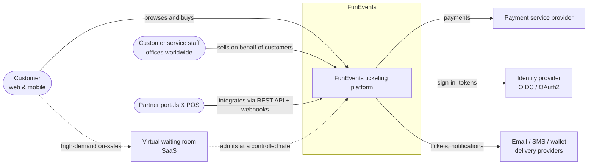
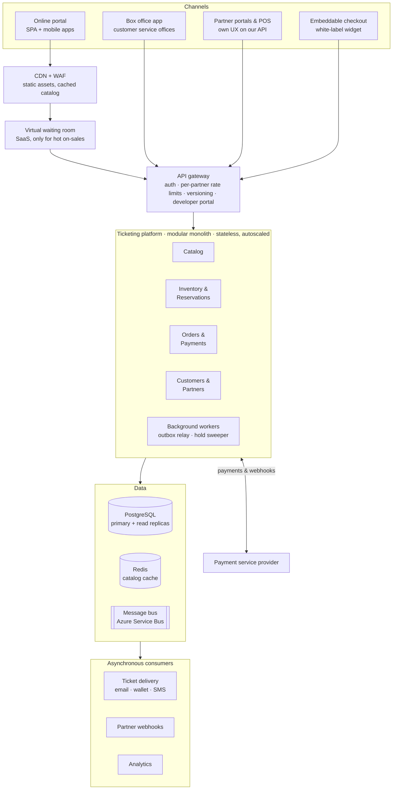
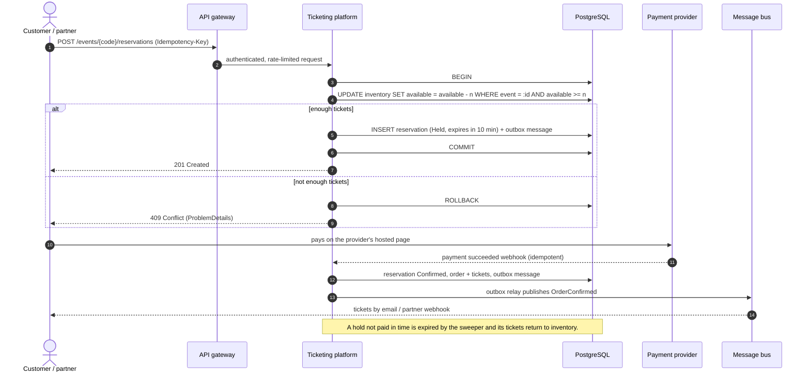
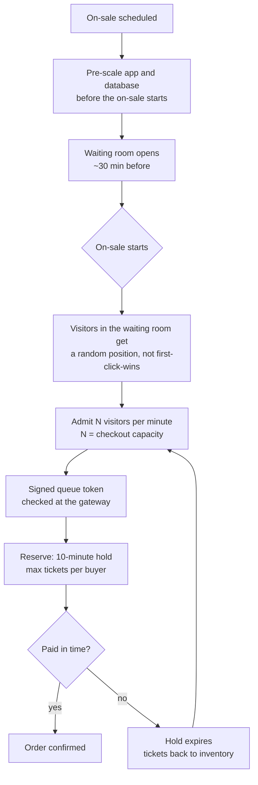
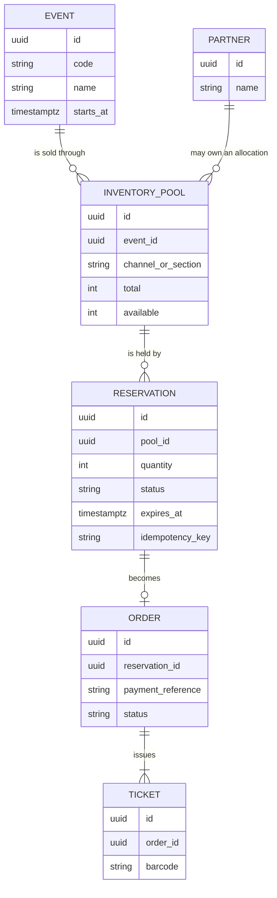

# FunEvents ticketing platform: architecture proposal

This document answers **Part 1** of the assessment: the overall architecture of a ticketing system for FunEvents, a fictional company that runs entertainment events (concerts, theatre, shows) and sells tickets through several channels.

- [1. Context and requirements](#1-context-and-requirements)
- [2. System context](#2-system-context)
- [3. Containers](#3-containers)
- [4. Key flows](#4-key-flows)
- [5. Inventory and consistency](#5-inventory-and-consistency)
- [6. Scalability and resilience](#6-scalability-and-resilience)
- [7. Security](#7-security)
- [8. Evolution path](#8-evolution-path)
- [9. How the prototype maps to this design](#9-how-the-prototype-maps-to-this-design)
- [10. References](#10-references)

---

## 1. Context and requirements

**Sales channels**

| Channel | Who uses it | What it needs |
|---|---|---|
| Online portal (main channel) | End customers, web and mobile | Fast catalog browsing, fair access during big on-sales, checkout |
| Customer service offices (worldwide) | FunEvents staff | Sell and manage tickets on behalf of customers, refunds, exchanges |
| Partner portals and points of sale | Third-party resellers | Integrate FunEvents into **their own** portal or POS and customise the buyer experience |

**Functional requirements**

1. Browse events and availability.
2. Reserve tickets for an event, then pay and receive them.
3. Expose the same capabilities to partners through a stable, documented API, plus notifications of what happened (webhooks).
4. Let partners who do not have a development team embed a branded checkout.

**Non-functional requirements**

| Requirement | Why it matters here |
|---|---|
| **Never oversell** | Selling a ticket that does not exist means refunds, angry customers and legal issues. Inventory needs strong consistency. |
| **Survive on-sale spikes** | Popular events receive many times their normal traffic in the first minutes. The read path and the entry door must absorb it. |
| **Fairness** | Buyers expect a queue, not a race that bots win. |
| **Partner isolation** | One partner misbehaving (bug, retry storm) must not degrade other channels. |
| **Global availability** | Offices and partners operate in several time zones. |
| **Observability** | On-sales are short; problems must be visible in minutes, not days. |

**Assumptions**

- Reads (catalog, availability) outnumber writes (reservations) by orders of magnitude.
- Traffic is spiky and mostly predictable: on-sale dates are known in advance.
- Payments go through an external payment service provider (PSP), so card data never touches FunEvents systems.

---

## 2. System context

---

## 3. Containers

Arrows into a group mean "any component of the group"; for example, the outbox relay is the only writer to the message bus.

| Container | Responsibility | Technology (Azure flavour) |
|---|---|---|
| CDN + WAF | Static assets, cached catalog pages, bot filtering | Azure Front Door |
| Virtual waiting room | Holds visitors before an on-sale and admits them at the rate checkout can handle | Bought as a service (Queue-it or similar), see [ADR-0004](adr/0004-buy-the-virtual-waiting-room.md) |
| API gateway | Single entry for every channel: OAuth2/OIDC validation, per-partner keys and quotas, API versions, developer portal with docs and sandbox | Azure API Management |
| Ticketing platform | Business logic, one deployable split into modules with their own schema | .NET 10, ASP.NET Core, containers on Azure Container Apps |
| PostgreSQL | Source of truth for inventory, reservations and orders (ACID) | Azure Database for PostgreSQL, flexible server |
| Redis | Read-heavy data: catalog, seat maps, availability snapshots | Azure Cache for Redis |
| Message bus | Asynchronous integration events | Azure Service Bus |
| Consumers | Ticket delivery, partner webhooks, analytics | Workers in the same platform or Azure Functions |

### Partner integration options

Partners want to customise the buyer experience. They get three levels, from most to least effort on their side:

1. **REST API + webhooks.** Full control of the UX. Versioned API, OAuth2 client credentials, an idempotency key on every write, and webhooks (`reservation.confirmed`, `order.refunded`...) signed with a shared secret so partners never need to poll.
2. **Embeddable checkout widget.** A white-label checkout they drop into their site with their own theme and language.
3. **Deep links** to the FunEvents portal with partner attribution.

Every partner gets a sandbox, its own credentials and its own rate limit at the gateway. Optionally, a partner can receive an **allocation**: a quota of tickets reserved for its channel, which guarantees its capacity and keeps its traffic away from the main inventory counter.

### Customer service offices

Offices use an internal app over the same API with staff roles (sell, refund, exchange). Selling requires the central inventory, so offices need connectivity. If an office must keep selling offline, the option is a pre-assigned allocation that it can sell locally and reconcile later, at the cost of flexibility.

---

## 4. Key flows

### 4.1 Reserve and pay

Key points:

- The reservation is a **temporary hold** (10 minutes, the same window Ticketmaster uses). The buyer pays within the window or the tickets go back on sale.
- The inventory decrement is a single **conditional update**: it only succeeds if enough tickets remain. See [ADR-0002](adr/0002-atomic-conditional-update-for-inventory.md).
- Every write accepts an **`Idempotency-Key`**, so retries from browsers, partners or the HTTP client never create a second reservation. See [ADR-0003](adr/0003-idempotency-keys.md).
- Events leave the database through an **outbox**, written in the same transaction, so a reservation can never exist without its event. The outbox is applied where consistency matters (inventory, payments), not everywhere.

### 4.2 High-demand on-sale

The waiting room turns an unpredictable spike into a constant flow. It does not remove the need to scale: it moves the bottleneck one step inwards, so inventory and payments keep their own limits (per-buyer caps, gateway rate limits, a bounded hold window).

---

## 5. Inventory and consistency

- **Source of truth:** PostgreSQL. Reservations need ACID guarantees; caches only serve reads.
- **General admission:** an `available` counter per pool, decremented with `UPDATE ... WHERE available >= n`. The row lock serialises concurrent buyers and the condition is re-checked after the lock, so the counter never goes below zero. A `CHECK (available >= 0)` constraint is the last safety net.
- **Assigned seating:** the same idea at seat level: `UPDATE seats SET status = 'held' WHERE id IN (...) AND status = 'available'`, and the reservation succeeds only if every seat was updated.
- **Hot rows:** a single counter per mega event is a contention point. Splitting it into pools (per section or per channel) spreads the locks, and the waiting room caps how many buyers arrive at once.
- **Integration events:** outbox pattern, at-least-once delivery and idempotent consumers.

---

## 6. Scalability and resilience

| Concern | Approach |
|---|---|
| Horizontal scale | Stateless instances behind the gateway, autoscaled on HTTP concurrency and queue depth. A modular monolith scales out like any service; what it cannot do is scale one module alone. |
| Predictable spikes | Scale out ahead of announced on-sales. Autoscaling alone reacts too late to a spike that peaks in minutes. |
| Read path | CDN, Redis and read replicas for catalog and availability. Availability can be a few seconds stale for display; the reservation is always checked against the primary. |
| Write path | Small, short transactions on the primary. Holds have a TTL so stuck reservations free themselves. |
| Partner isolation | Per-partner quotas at the gateway, bulkheads and circuit breakers on outgoing calls (PSP, webhooks). |
| Regions | Reads served close to users; writes go to one primary region to keep inventory consistent. Per-event home regions are a later option if latency requires it. |
| Observability | OpenTelemetry traces, metrics and logs. On-sale dashboard: queue length, admission rate, hold-to-order conversion, rate of 409 responses, p99 latency. |

---

## 7. Security

- Customers sign in with OIDC. Partners use OAuth2 client credentials with scoped permissions. Office staff have role-based access.
- Card data stays with the PSP (hosted payment page or hosted fields), keeping PCI scope minimal.
- Webhooks from and to partners are signed and verified.
- Bot mitigation at the edge (WAF rules, device fingerprinting through the waiting room) and per-buyer ticket limits.

---

## 8. Evolution path

1. **Start as a modular monolith.** One deployable, modules with clear boundaries and their own schema, talking through in-process interfaces and events. A small team ships faster and pays no distributed-systems tax it does not need yet. See [ADR-0001](adr/0001-modular-monolith.md).
2. **Extract when there is a reason.** The first candidate is *Inventory & Reservations*: it has the most load, the strictest consistency needs and the busiest release cadence during on-sales. Because the module already owns its schema and publishes events, it can be extracted with the strangler-fig approach.
3. **Keep the rest together** until scale, team size or release independence justify splitting it.

Shopify followed a similar path: a modular monolith that handles very large flash sales, with specific pieces (such as storefront rendering) extracted when they needed to scale or deploy independently.

---

## 9. How the prototype maps to this design

The prototype (Part 2) implements the **Inventory & Reservations** slice and a console client to test it. The detailed plan is in [`implementation-plan.md`](implementation-plan.md).

| Design element | How the prototype applies it |
|---|---|
| Atomic conditional update | `ReserveTickets` use case, `ExecuteUpdateAsync` with `WHERE AvailableTickets >= quantity` inside a transaction |
| Idempotency keys | `Idempotency-Key` header, unique index, replay of the first result |
| Consistent errors | RFC 9457 ProblemDetails for 400, 404, 409 and 422 |
| Validation in one place | .NET 10 built-in Minimal API validation (DataAnnotations on the contracts) |
| Observability | Aspire ServiceDefaults: OpenTelemetry traces, metrics, logs and health checks |
| Orchestration | Aspire AppHost: PostgreSQL container, API and console client |

Deliberate simplifications, listed so they are not mistaken for omissions:

- A reservation takes the tickets immediately; there is no hold expiry or payment step.
- One inventory counter per event instead of pools.
- No gateway, authentication or waiting room; they belong to infrastructure, not to the prototype.
- No outbox: the prototype does not publish events.

---

## 10. References

- Ticketmaster, *Guide to Smart Queue*: waiting room, randomised queue and the 10-minute hold.
- SeatGeek at QCon, *How SeatGeek Successfully Handles High Demand Ticket On-Sales*: in-house virtual waiting room on AWS and Fastly.
- Shopify Engineering, *Cloud load and modular code*: modular monolith under flash-sale traffic.
- ByteByteGo, *System Design Interview*, hotel reservation chapter: relational database for ACID, reservation id as idempotency key.
- NetMentor (Iván Abad), *Construyendo sistemas distribuidos* and the articles on idempotency, event consistency (outbox) and the Core-Driven architecture.

## Architecture decision records

| ADR | Decision |
|---|---|
| [0001](adr/0001-modular-monolith.md) | Start as a modular monolith |
| [0002](adr/0002-atomic-conditional-update-for-inventory.md) | Prevent overselling with an atomic conditional update |
| [0003](adr/0003-idempotency-keys.md) | Idempotency keys on reservation requests |
| [0004](adr/0004-buy-the-virtual-waiting-room.md) | Buy the virtual waiting room instead of building it |
| [0005](adr/0005-core-driven-structure.md) | Core-Driven structure for the prototype |
| [0006](adr/0006-dotnet-10-minimal-apis-aspire.md) | .NET 10, Minimal APIs and Aspire |
