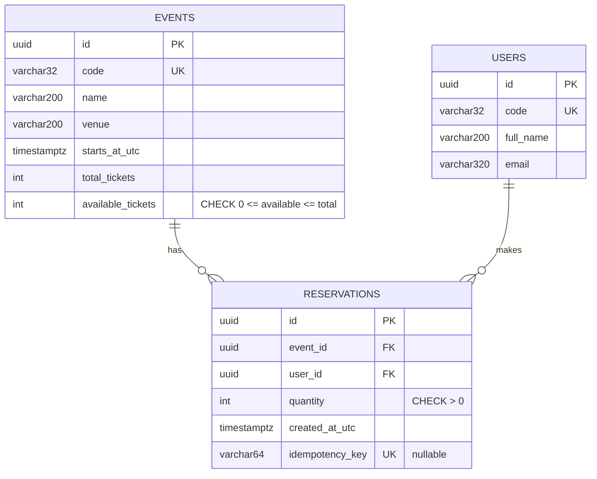
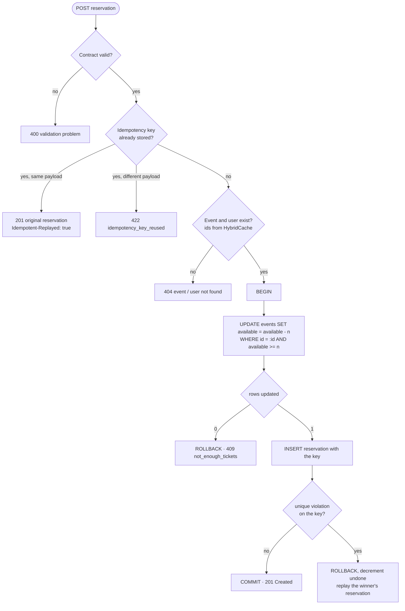

# Part 2: implementation plan

The prototype is a console client that reserves tickets for a known event and user through a web API. This document is the analysis behind it: what to build, how each piece must behave, how to prove it works, and the order to build it in.

- [1. Scope](#1-scope)
- [2. Solution layout](#2-solution-layout)
- [3. API contract](#3-api-contract)
- [4. Data model](#4-data-model)
- [5. The reservation algorithm](#5-the-reservation-algorithm)
- [6. Console client](#6-console-client)
- [7. Test plan](#7-test-plan)
- [8. Build order](#8-build-order)
- [9. Pitfalls to watch for](#9-pitfalls-to-watch-for)
- [10. Ready for the live change](#10-ready-for-the-live-change)

---

## 1. Scope

**In scope**

- `POST` a reservation for an event code and a user code; read an event and a reservation.
- Never oversell under concurrency.
- Safe retries through an `Idempotency-Key` header.
- Validation and consistent ProblemDetails errors.
- A console client that runs one reservation, or many in parallel to show the guarantees.
- PostgreSQL, orchestrated with Aspire; integration tests against a real PostgreSQL.

**Out of scope** (part of the full design, see [architecture §9](architecture.md#9-how-the-prototype-maps-to-this-design)): holds with expiry, payment, outbox and events, authentication, rate limiting, inventory pools.

---

## 2. Solution layout

```text
src/
├── FunEvents.AppHost/           Aspire: PostgreSQL + API + client scenarios
├── FunEvents.ServiceDefaults/   OpenTelemetry, health checks, service discovery, resilience (Aspire template)
├── FunEvents.Contracts/         Request/response records shared by API and client (no dependencies)
├── FunEvents.Api/
│   ├── Endpoints/               Routing, binding, Result → HTTP. No business logic
│   ├── UseCases/                ReserveTickets, GetReservation, GetEvent (one class per action)
│   ├── Data/                    DbContext, entities, migrations, seed data
│   ├── Common/                  Result<T>, Error
│   └── Program.cs
└── FunEvents.ConsoleClient/     Typed HttpClient + scenarios
tests/
└── FunEvents.Api.Tests/         WebApplicationFactory + Testcontainers PostgreSQL
```

Rules (Core-Driven, [ADR-0005](adr/0005-core-driven-structure.md)):

- Endpoints → use cases → data. Never the other way round.
- Use cases are concrete classes registered in DI. No MediatR, no interface per use case, no repository over EF Core.
- Use cases return `Result<T>` with DTOs from `FunEvents.Contracts`; entities never leave the API.
- One place maps `Error` → HTTP status + ProblemDetails.
- Commands (`ReserveTickets`) and queries (`GetEvent`, `GetReservation`) are separate classes; queries use `AsNoTracking()` and project straight to DTOs ([ADR-0008](adr/0008-cqrs-at-use-case-level.md)).
- Immutable code → id lookups go through HybridCache, in-memory only ([ADR-0007](adr/0007-hybridcache-for-reference-data.md)).

Solution-wide settings: `global.json` pinned to .NET 10, `Directory.Build.props` (nullable, warnings as errors, analyzers), `Directory.Packages.props` (Central Package Management).

---

## 3. API contract

### Endpoints

| Method | Route | Success | Errors |
|---|---|---|---|
| `GET` | `/events/{eventCode}` | `200` event + availability | `404 event_not_found` |
| `POST` | `/events/{eventCode}/reservations` | `201` + `Location` | `400`, `404 event_not_found`, `404 user_not_found`, `409 not_enough_tickets`, `422 idempotency_key_reused` |
| `GET` | `/reservations/{reservationId}` | `200` | `404 reservation_not_found` |

### Request and responses

```jsonc
// POST /events/ROCK-BCN-2027/reservations
// Idempotency-Key: 3f6c1c1e-8d0b-4a57-9a51-2f1f3c8f6a10   (optional, max 64 chars)
{ "userCode": "USR-001", "quantity": 2 }   // userCode required, ≤ 32 chars; quantity 1..10

// 201 Created, Location: /reservations/{id}
{ "id": "…", "eventCode": "ROCK-BCN-2027", "userCode": "USR-001", "quantity": 2, "createdAtUtc": "…" }

// GET /events/ROCK-BCN-2027 → 200
{ "code": "ROCK-BCN-2027", "name": "Rock Night Barcelona", "venue": "…", "startsAtUtc": "…",
  "totalTickets": 500, "availableTickets": 498 }
```

### Errors

RFC 9457 ProblemDetails, plus a machine-readable `code` extension:

```json
{
  "type": "https://tools.ietf.org/html/rfc9110#section-15.5.10",
  "title": "Conflict with the current state",
  "status": 409,
  "detail": "Event 'JAZZ-VLC-2027' does not have 3 ticket(s) available.",
  "code": "not_enough_tickets"
}
```

Validation errors (`400`) come from the framework with an `errors` dictionary per field. Malformed JSON must also be `400`, never `500`.

### Idempotency rules ([ADR-0003](adr/0003-idempotency-keys.md))

| Situation | Response |
|---|---|
| No key | Normal behaviour, every request is a new reservation |
| New key | Normal behaviour, key stored on the reservation |
| Known key, same event, user and quantity | `201` with the **original** reservation and `Idempotent-Replayed: true`; no tickets taken |
| Known key, different payload | `422 idempotency_key_reused` |
| Two requests with the same new key at the same moment | One reservation; both answer `201` with it |

---

## 4. Data model



- Snake-case names (PostgreSQL convention).
- Ids are UUIDv7 (`Guid.CreateVersion7()`): time-ordered, friendly to B-tree indexes. Channels only see the public codes.
- The `CHECK` on `available_tickets` is the safety net: even a future bug cannot make it negative.
- The unique index on `idempotency_key` is what makes same-key races safe (PostgreSQL allows many `NULL`s in a unique index).

**Seed data** (applied with the migrations in Development):

| Event code | Name | Tickets |
|---|---|---|
| `ROCK-BCN-2027` | Rock Night Barcelona | 500 |
| `HAMLET-MAD-2027` | Hamlet | 120 |
| `JAZZ-VLC-2027` | Jazz under the Stars | 10, small on purpose for the concurrency demo |

Users `USR-001`, `USR-002`, `USR-003`.

---

## 5. The reservation algorithm



The event and user lookups are the only cached reads: their ids never change. Availability is never cached; it is decided by the `UPDATE` inside the transaction.

Why this shape ([ADR-0002](adr/0002-atomic-conditional-update-for-inventory.md)):

- **Read-check-write is wrong:** two requests read "1 left" and both sell it.
- **The conditional update is right:** PostgreSQL locks the row, the second request waits, then re-evaluates the `WHERE` with the new value. One round trip, no retry loop.
- **Same transaction for update and insert:** a failed insert (for example, a same-key race) undoes the decrement.

EF Core sketch:

```csharp
// Inside the configured execution strategy (Aspire enables EF Core retries).
await using var transaction = await db.Database.BeginTransactionAsync(ct);

var updated = await db.Events
    .Where(e => e.Id == eventId && e.AvailableTickets >= quantity)
    .ExecuteUpdateAsync(s => s.SetProperty(e => e.AvailableTickets, e => e.AvailableTickets - quantity), ct);

if (updated == 0) return ReservationErrors.NotEnoughTickets(eventCode, quantity);

db.Reservations.Add(reservation);
await db.SaveChangesAsync(ct);
await transaction.CommitAsync(ct);
```

---

## 6. Console client

```text
FunEvents.ConsoleClient --event <code> --user <code> [--quantity n] [--parallel n] [--idempotency-key key] [--api-url url]
```

Behaviour:

1. Shows the event and its availability (`GET /events/{code}`).
2. Reserves: once, or `--parallel n` requests at the same time.
3. Prints the result (reservation, or the ProblemDetails title and detail), or a summary by status code for parallel runs: how many created, how many `409`, distinct reservations, tickets taken.
4. Shows the availability again.
5. Exit code `0` on success, `1` when rejected, `2` on bad arguments.

Each request carries a fresh `Idempotency-Key` unless one is passed, which is what makes the built-in HTTP retries safe for a `POST`.

The HTTP client is typed, with service discovery (`https+http://api`), resilience and OpenTelemetry from ServiceDefaults, so its calls appear in the Aspire dashboard trace together with the API and the SQL.

**AppHost scenarios** (started on demand from the dashboard with `WithExplicitStart`):

| Resource | Arguments | Expected |
|---|---|---|
| `client-reserve` | `--event ROCK-BCN-2027 --user USR-001 --quantity 2` | one reservation, 498 left |
| `client-rush` | `--event JAZZ-VLC-2027 --user USR-002 --parallel 50` | exactly 10 created, 40 × `409`, 0 left |

---

## 7. Test plan

Integration tests: the API hosted in memory with `WebApplicationFactory`, PostgreSQL in Testcontainers, shared once for the whole test assembly. Each test creates its own event and user, so tests never compete for the same inventory.

| # | Test | Expected |
|---|---|---|
| 1 | Reserve 3 of 10 | `201`, body matches, `Location` set, 7 left |
| 2 | Unknown event | `404 event_not_found` |
| 3 | Unknown user | `404 user_not_found`, inventory unchanged |
| 4 | Quantity 0, −1, 11 | `400` with a `Quantity` error, inventory unchanged |
| 5 | Missing user code | `400` with a `UserCode` error |
| 6 | Malformed JSON | `400` |
| 7 | Ask for 3 when 2 are left | `409 not_enough_tickets`, still 2 left |
| 8 | Take the last 4 of 4 | `201`, 0 left |
| 9 | Read back a reservation | `200`, identical to the `201` body |
| 10 | Unknown reservation id | `404 reservation_not_found` |
| 11 | Event availability after a reservation | totals correct |
| 12 | Same key and payload twice | both `201`, same id, second has `Idempotent-Replayed: true`, tickets taken once |
| 13 | Same key, different quantity | `422 idempotency_key_reused`, inventory unchanged |
| 14 | No key, two requests | two reservations |
| 15 | Key of 65 characters | `400`, inventory unchanged |
| 16 | 20 concurrent requests, same key | all `201`, one distinct id, one reservation, 1 ticket taken |
| 17 | **50 concurrent buyers, 10 tickets** | exactly 10 × `201`, 40 × `409`, 0 left, 10 reserved |
| 18 | **30 concurrent buyers of 3, 10 tickets** | exactly 3 × `201`, 1 left |
| 19 | Reserve for an unknown event, create it, reserve again | `404` then `201`: a cache miss is not remembered |

Tests 16 to 18 are the ones to show in the review: they prove the guarantees, not just the happy path.

---

## 8. Build order

Each step is one commit that builds and runs, so the history tells the story.

| # | Commit | Done when |
|---|---|---|
| 1 | `chore:` solution, `global.json`, shared props, Central Package Management | `dotnet build` passes on an empty solution |
| 2 | `feat:` AppHost + ServiceDefaults + empty API waiting for PostgreSQL | `dotnet run --project src/FunEvents.AppHost` shows a healthy `api` |
| 3 | `feat(data):` entities, `DbContext`, constraints, migration, seed | the three events exist after startup |
| 4 | `feat(reservations):` `ReserveTickets`, `GetEvent`, `GetReservation`, `Result<T>`, contracts | use cases compile and are registered |
| 5 | `feat(api):` endpoints, `AddValidation`, ProblemDetails, OpenAPI + Scalar | `curl` covers 201 / 400 / 404 / 409 |
| 6 | `feat(reservations):` `Idempotency-Key` | replay, 422 and same-key race behave as in §3 |
| 7 | `perf(reservations):` HybridCache for event and user lookups | two fewer queries per reservation; misses not cached |
| 8 | `feat(client):` console client + AppHost scenarios | `client-rush` prints 10 created / 40 conflicts |
| 9 | `test:` integration tests from §7 | `dotnet test` green, several runs in a row |
| 10 | `ci:` GitHub Actions build + test | green badge |
| 11 | `docs:` README: run instructions, sample output | someone else can clone and run it |

---

## 9. Pitfalls to watch for

Things that are easy to get wrong with this exact stack:

| Pitfall | What happens | Fix |
|---|---|---|
| Explicit transaction with Aspire's EF integration | Aspire enables EF Core retries, and `BeginTransaction` then throws "the execution strategy does not support user-initiated transactions" | Run the transaction inside `db.Database.CreateExecutionStrategy().ExecuteAsync(...)` and clear the change tracker at the start of each attempt |
| Timestamp precision | .NET has 100 ns ticks, PostgreSQL stores microseconds: the `201` body and the value read back differ | Truncate `now` to microseconds before saving |
| Malformed JSON in Development | `ThrowOnBadRequest` is on in Development, so with `UseExceptionHandler` a bad body becomes `500` | `Configure<RouteHandlerOptions>(o => o.ThrowOnBadRequest = false)` |
| Tests starting the server lazily | Parallel test classes can start the host twice and run the seeding twice (duplicate key on the event code) | Start the server once in the fixture's `InitializeAsync` |
| xUnit v3 with .NET 10 SDK | VSTest is no longer supported for Microsoft.Testing.Platform-based test projects | Add `"test": { "runner": "Microsoft.Testing.Platform" }` to `global.json` |
| Mixed EF Core versions | Aspire pulls one EF Core patch, `Microsoft.EntityFrameworkCore.Design` another: MSB3277 warnings, errors with warnings-as-errors | `CentralPackageTransitivePinningEnabled` + pin `Microsoft.EntityFrameworkCore.Relational` |
| `Program` and `WebApplicationFactory` | Older templates needed `public partial class Program` | Not needed on .NET 10 |
| Console client configuration | `Host.CreateApplicationBuilder()` uses the current directory as content root, so `appsettings.json` next to the exe is ignored when run from the repo root | `ContentRootPath = AppContext.BaseDirectory` |
| Console project name | A project called `FunEvents.Console` makes `Console.WriteLine` resolve to the namespace | Name it `FunEvents.ConsoleClient` |
| Noisy client output | HttpClient and Polly log every attempt with stack traces | Raise `System.Net.Http.HttpClient` and `Polly` log levels in the client's `appsettings.json` |
| PostgreSQL image | Aspire 13.6 uses `postgres:18.3` by default | Use the same image in Testcontainers |
| Caching a miss | `HybridCache.GetOrCreateAsync` stores whatever the factory returns, `null` included: an event created later stays "not found" until expiry | When the lookup returns `null`, call `RemoveAsync(key)` |
| Caching availability | A cached counter shows tickets that are gone, and if it were ever used for the decision it would oversell | Never cache availability; the `UPDATE` decides |
| HybridCache with warnings as errors | Some HybridCache APIs may be flagged as experimental (`EXTEXP` diagnostics) | Suppress the specific diagnostic where it is used, with a comment |
| Validation in another assembly | Worth checking that `AddValidation` picks up DataAnnotations on records in `FunEvents.Contracts` | It does on .NET 10; types must be public |

---

## 10. Ready for the live change

The review includes a small change made live. The likely ones and where they land:

| Change | Where | Notes |
|---|---|---|
| Cancel a reservation | new `CancelReservation` use case + `DELETE /reservations/{id}` | Mirror of the reserve: `UPDATE ... SET available = available + n WHERE available + n <= total`; mark the reservation cancelled in the same transaction |
| Max tickets per user per event | `ReserveTickets` | Sum the user's quantity for the event inside the transaction; new `409` code |
| Holds that expire | `ReservationEntity` (`Status`, `ExpiresAtUtc`) + a `BackgroundService` | Sweeper returns expired holds with the same conditional update |
| List a user's reservations | new `GetUserReservations` use case + `GET /users/{code}/reservations` | Read-only projection |
| Change the per-request limit | `ReservationLimits.MaxTicketsPerReservation` | Validation picks it up; add a test |

Practise one of them before the review, on your own machine, from a clean clone.
